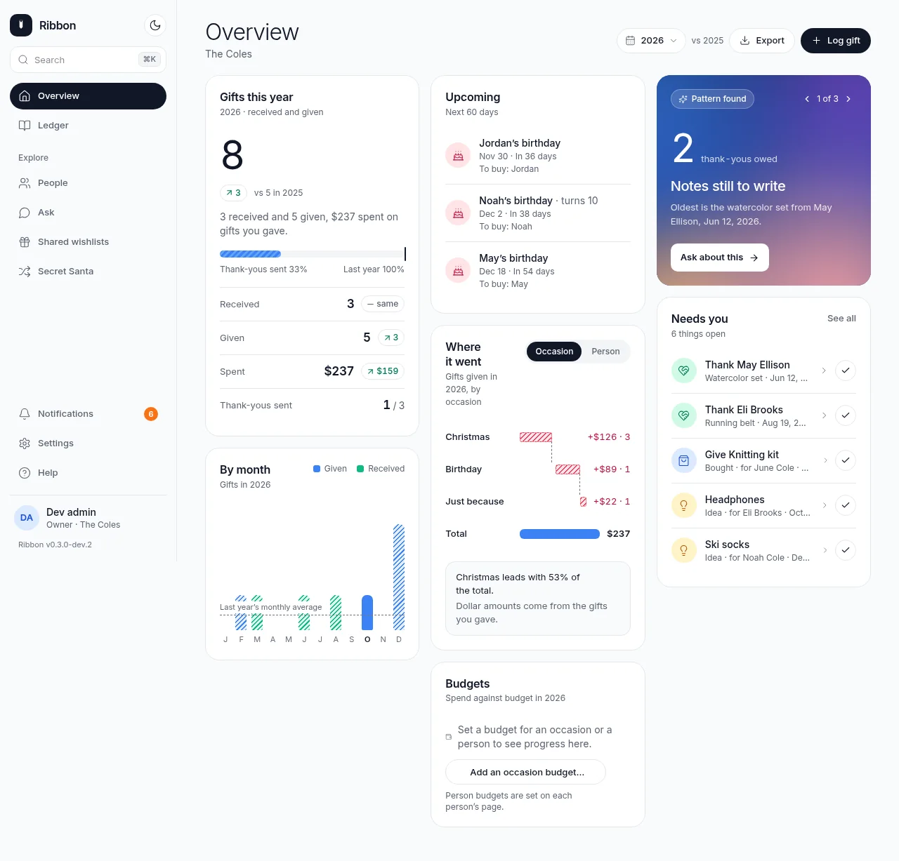
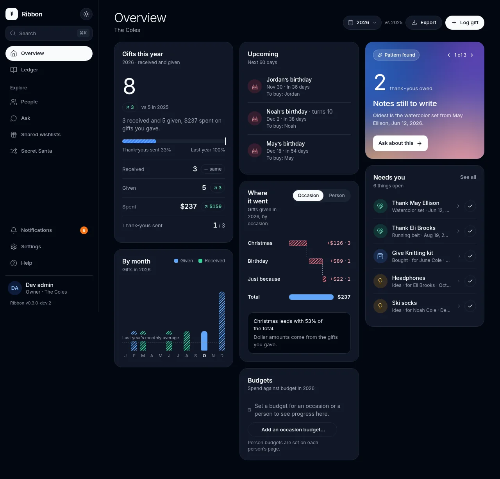
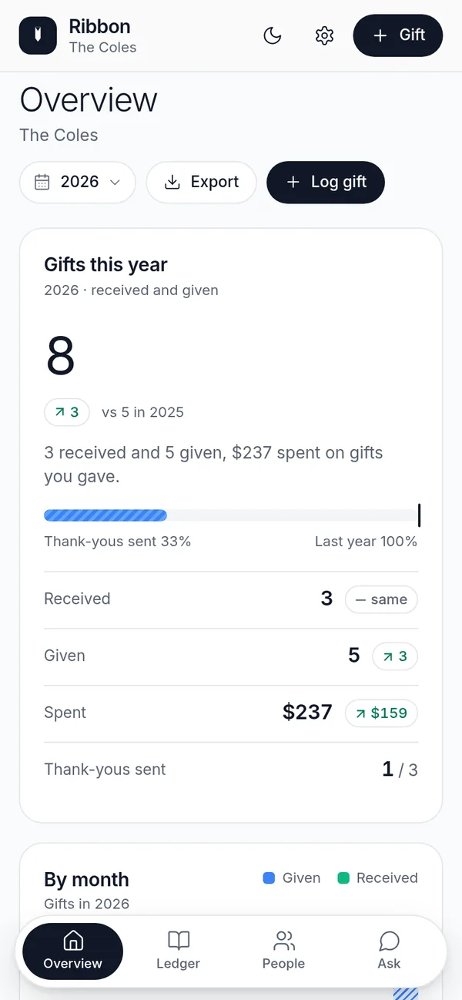
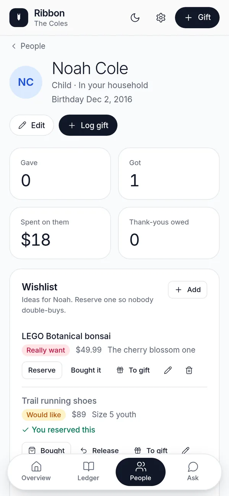
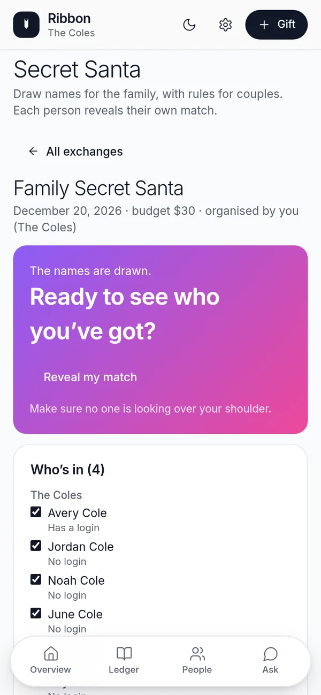
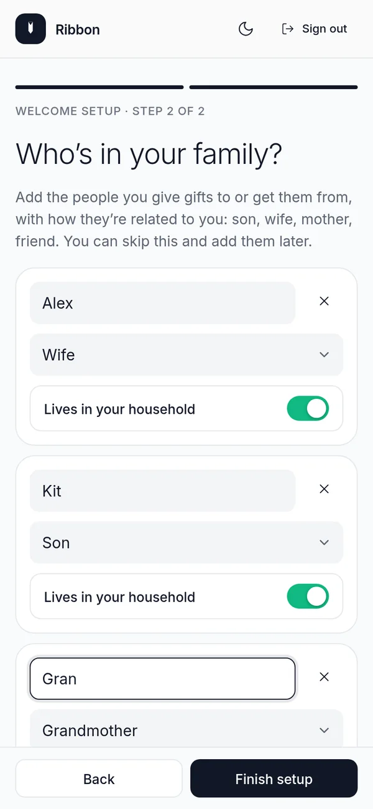
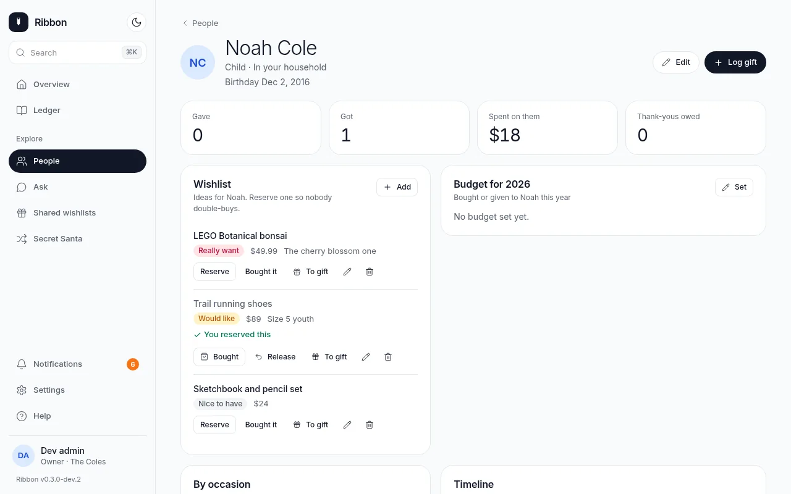
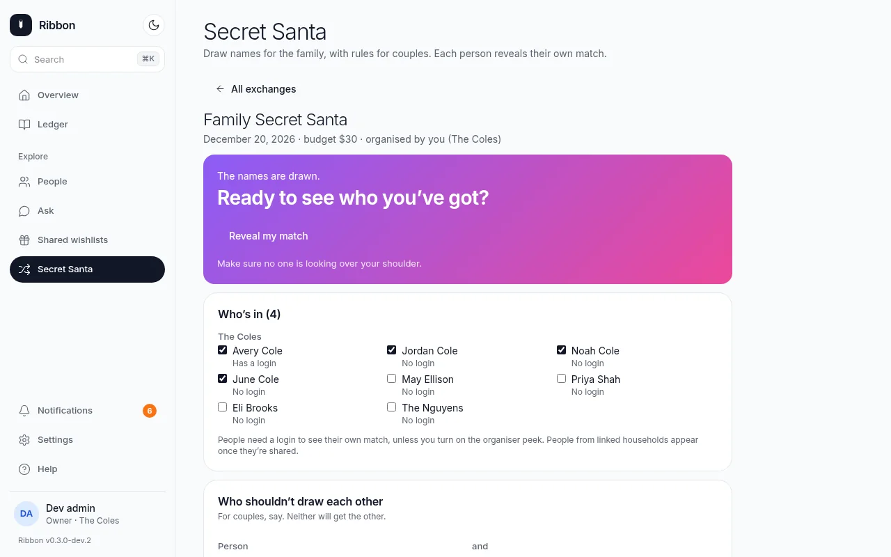
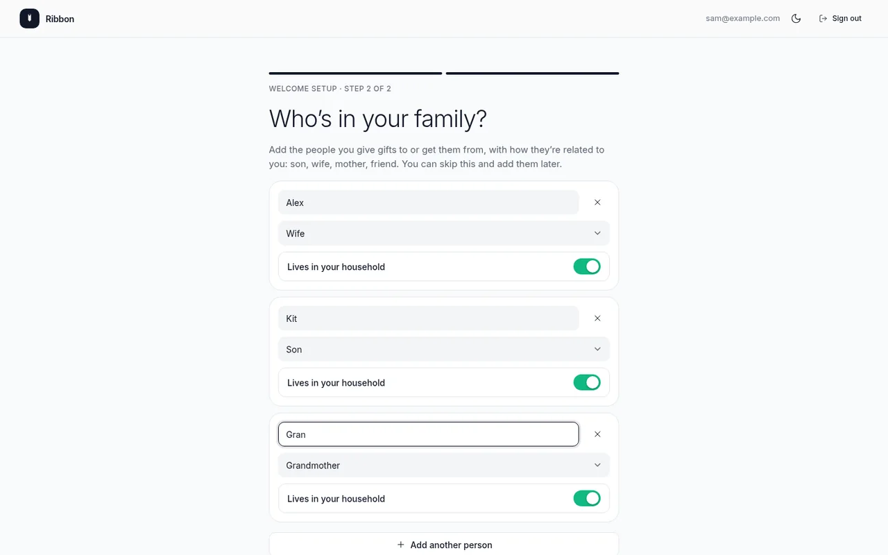
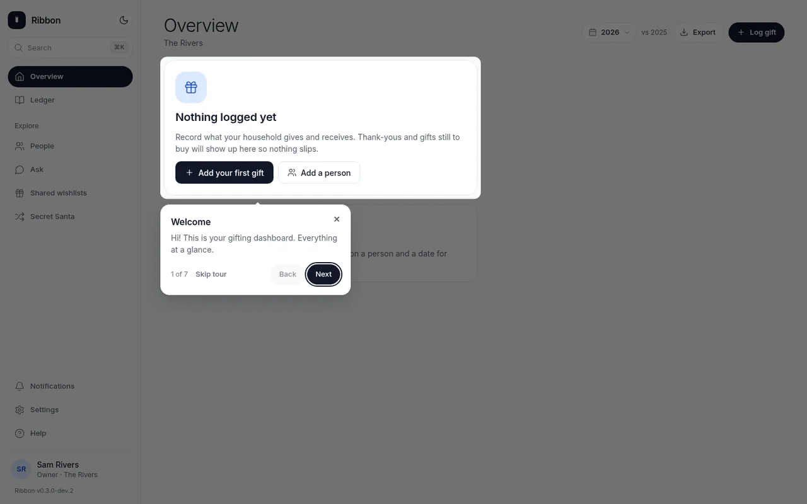

<div align="center">


# Ribbon

**A mobile-first family gift tracker you host yourself.**

Keep track of the gifts your household gives and gets, see what still needs you, and keep it all on your own server.

[](https://github.com/thepizzatech/ribbon/actions/workflows/ci.yml)
[](https://ribbon.thepizza.tech)
[](LICENSE)
[](CHANGELOG.md)
[](#status-and-roadmap)
[](https://github.com/thepizzatech/ribbon/pkgs/container/ribbon)

[**Documentation**](https://ribbon.thepizza.tech) · [Quick start](#quick-start) · [Features](#features) · [Configuration](#configuration) · [Security](#security) · [Changelog](CHANGELOG.md)

</div>

<br>

<table>
  <tr>
    <th align="center">Light</th>
    <th align="center">Dark</th>
  </tr>
  <tr>
    <td></td>
    <td></td>
  </tr>
</table>

## What is Ribbon?

Ribbon is a small web app for a family's gifts: what you gave, what you got, who still needs a thank-you, and what is still left to buy for the next birthday. It is designed for the phone first, installs as an app, and follows your light or dark theme.

Everything (family, people, gifts, occasions, logins) lives in **one SQLite file on your own server**, so every phone and laptop in the family sees the same data and nothing goes to anyone else's cloud. It runs as a single Docker container.

> [!NOTE]
> **Status: in development (`0.3.0-dev`).** It works and keeps your data on your server, but there is no release yet and you should expect rough edges. It is built for one family. See [Status and roadmap](#status-and-roadmap).

## Features

- **Gift ledger and overview.** Log gifts given and received; see this year against last year, where the money went by occasion or person, and a **Needs you** list of thank-yous owed and gifts still to buy.
- **Surprise-safe wishlists.** Reserve or mark an item bought so nobody double-buys. The person whose list it is never sees the marks, and the server enforces it, even through the API.
- **Budgets.** Yearly budgets per person or per occasion, shown against what you have spent.
- **Upcoming dates and a calendar feed.** Birthdays, anniversaries and yearly occasions with a countdown, plus a secret ICS link for Google, Apple or Outlook calendar.
- **Secret Santa.** Draw names across a household or linked households, with exclusions (couples, last year's match) and no peeking.
- **Sharing between households.** One server can hold several households, each with a private ledger. Link two with a short single-use code and share just the people you choose.
- **Sign-in your way.** Passwords, **passkeys** and **single sign-on** (OpenID Connect), with sign-in lockout and optional first-owner setup code.
- **Backups.** Scheduled nightly snapshots, download and restore from the app, plus JSON and **CSV** import and export with a preview.
- **Installable app (PWA)** over HTTPS, with a seven-step guided tour and a Welcome setup for new families.
- **Ask** (optional). Plain-language questions about your ledger, if you give it an xAI API key.

More detail in [docs/FEATURES.md](docs/FEATURES.md) or on the [docs site](https://ribbon.thepizza.tech/FEATURES/).

## Screenshots

Light and dark follow your GitHub theme.

<table>
  <tr>
    <td width="25%"><picture><source media="(prefers-color-scheme: dark)" srcset="docs/assets/screenshots/overview-mobile-dark.webp"></picture></td>
    <td width="25%"><picture><source media="(prefers-color-scheme: dark)" srcset="docs/assets/screenshots/wishlist-mobile-dark.webp"></picture></td>
    <td width="25%"><picture><source media="(prefers-color-scheme: dark)" srcset="docs/assets/screenshots/secret-santa-mobile-dark.webp"></picture></td>
    <td width="25%"><picture><source media="(prefers-color-scheme: dark)" srcset="docs/assets/screenshots/welcome-setup-mobile-dark.webp"></picture></td>
  </tr>
  <tr>
    <td align="center"><sub>Overview</sub></td>
    <td align="center"><sub>Wishlist and budget</sub></td>
    <td align="center"><sub>Secret Santa</sub></td>
    <td align="center"><sub>Welcome setup</sub></td>
  </tr>
</table>

<table>
  <tr>
    <td width="50%"><picture><source media="(prefers-color-scheme: dark)" srcset="docs/assets/screenshots/wishlist-desktop-dark.webp"></picture></td>
    <td width="50%"><picture><source media="(prefers-color-scheme: dark)" srcset="docs/assets/screenshots/secret-santa-desktop-dark.webp"></picture></td>
  </tr>
  <tr>
    <td align="center"><sub>A person's page: wishlist, budget, timeline</sub></td>
    <td align="center"><sub>Secret Santa, drawn</sub></td>
  </tr>
  <tr>
    <td width="50%"><picture><source media="(prefers-color-scheme: dark)" srcset="docs/assets/screenshots/welcome-setup-desktop-dark.webp"></picture></td>
    <td width="50%"><picture><source media="(prefers-color-scheme: dark)" srcset="docs/assets/screenshots/tour-desktop-dark.webp"></picture></td>
  </tr>
  <tr>
    <td align="center"><sub>Welcome setup for a new family</sub></td>
    <td align="center"><sub>The guided tour</sub></td>
  </tr>
</table>

## Quick start

You need Docker with the Compose plugin. Ribbon is published as [`ghcr.io/thepizzatech/ribbon`](https://github.com/thepizzatech/ribbon/pkgs/container/ribbon). There is no release yet, so run the **`dev`** tag (built from the newest `main`):

```bash
mkdir ribbon && cd ribbon
curl -fsSLO https://raw.githubusercontent.com/thepizzatech/ribbon/main/docker-compose.yml
echo "RIBBON_TAG=dev" > .env
docker compose pull
docker compose up -d
```

Open **`http://<your-server-ip>:8080`**. The first visit only creates the **owner account**. Right after you sign in, a **Welcome setup** asks for your family's name and who is in it, then opens an empty Overview and a short guided tour. Add the rest of the family's logins later in **Settings**.

> [!IMPORTANT]
> **Reachable from the internet?** Until the first owner exists, anyone who can open the page could claim it. Add `SETUP_CODE=<something long>` to `.env` **before** you start, and type it once on the first visit. Without a code, Ribbon only lets the first owner be created from your home network.

**HTTPS.** Ribbon speaks **plain HTTP on port 8080**. That is fine on your home network. To reach it from outside, or to install it as an app on a phone, put it behind **your own HTTPS reverse proxy** (Caddy, Nginx Proxy Manager, Traefik, Tailscale, Cloudflare Tunnel) and set `PUBLIC_URL=https://ribbon.example.com`. Recipes are in [docs/REVERSE-PROXY.md](docs/REVERSE-PROXY.md). A bundled Caddy overlay does it in one line:

```bash
SITE_ADDRESS=ribbon.example.com docker compose -f docker-compose.yml -f docker-compose.caddy.yml up -d
```

Your data lives in the `ribbon_data` Docker volume and survives restarts and `docker compose down` (only `down -v` deletes it). To build from source instead: `docker compose -f docker-compose.yml -f docker-compose.build.yml up -d --build`.

**Updating:** `docker compose pull && docker compose up -d`. See [Upgrading](https://ribbon.thepizza.tech/upgrading/) first for notes and backups.

## Configuration

Settings are environment variables in a `.env` file next to `docker-compose.yml` (start from [`.env.example`](.env.example); never commit your `.env`). Everything is optional.

| Variable | Default | What it does |
| --- | --- | --- |
| `RIBBON_TAG` | `latest` | Image tag. Use `dev` until the first release exists. |
| `PORT` | `8080` | Host port to publish (the app always listens on 8080 inside). |
| `PUBLIC_URL` | unset | The `https://` address people type when behind a proxy. |
| `TRUSTED_PROXIES` | loopback + private ranges | Peers whose `X-Forwarded-*` headers are believed (`none`, or a CIDR list). |
| `SETUP_CODE` | unset | Code required to create the first owner. Set it if the server is reachable from outside. |
| `ALLOW_INSECURE_LOGIN` | `false` | Allow password sign-in over plain HTTP from public addresses. |
| `ALLOW_PUBLIC_SETUP` | `false` | Allow creating the first owner from a public address with no code. Not recommended. |
| `OIDC_ISSUER`, `OIDC_CLIENT_ID`, `OIDC_CLIENT_SECRET` | unset | Turn on single sign-on. |
| `BACKUP_CRON` | `0 3 * * *` | When to take scheduled backups; `off` disables. |
| `BACKUP_KEEP` | `14` | How many scheduled backups to keep. |
| `XAI_API_KEY` | unset | Turns on the Ask page (sends a trimmed copy of your gift list to xAI). |

The full list (SSO tuning, HSTS, the tour, sample data, ...) is in the [configuration reference](docs/configuration.md) on the [docs site](https://ribbon.thepizza.tech/configuration/).

## Security

Ribbon is meant to be exposed carefully, and has had a full review against a running production build ([docs/SECURITY-AUDIT.md](docs/SECURITY-AUDIT.md): no cross-household data access, SQL injection, stored XSS or sign-in bypass found; the issues that were found are fixed and covered by tests).

- Passwords use **scrypt** (N=2^16); sessions are server-side, cookies are `HttpOnly`, `SameSite=Lax` and `Secure` over HTTPS; every write needs a CSRF token and a same-site Origin.
- Sign-in **lockout** per account and address that a forged `X-Forwarded-For` cannot dodge; **passkeys** require user verification; optional **SSO** with PKCE.
- Password sign-in over plain HTTP is **refused from public addresses**; `X-Forwarded-*` is trusted only from configured proxies; the first owner can only be created from your home network unless you set `SETUP_CODE`.
- Surprises stay surprises: the server strips reserved marks and planned gifts from what the recipient can see.
- The container runs as an unprivileged user with **all capabilities dropped** and `no-new-privileges`. Backups are owner-only on disk.

What is on you when self-hosting: use an HTTPS proxy and `PUBLIC_URL`, do not publish port 8080 to the internet, back up the `ribbon_data` volume, and keep `.env` out of git. See [Securing your install](https://ribbon.thepizza.tech/securing/) and the [security policy](SECURITY.md). To report a vulnerability privately, use the **Security** tab → **Report a vulnerability**.

## Status and roadmap

Ribbon is in **active development**: the current build is `0.3.0-dev.2` and there is **no release, beta branch or tag yet**. The `dev` image tracks `main`.

- Done: the ledger, wishlists, budgets, upcoming dates and ICS feed, Secret Santa, sharing between households, CSV, passkeys and SSO, scheduled backups, the Welcome setup and tour, a full security review.
- Next: cut the first beta (see [docs/RELEASING.md](docs/RELEASING.md); the multi-arch release build has not been run yet), then publish versioned image tags.
- Always: keep it small, self-hostable, and private by default.

Release notes live in the [CHANGELOG](CHANGELOG.md).

## Develop

Needs Node 22.13 or newer (Ribbon uses Node's built-in `node:sqlite`).

```bash
npm ci
DATA_DIR=./data npm run dev      # http://localhost:8080
```

In development a sample household and a dev login are created (username `admin`, password `ribbon-dev-password`; see the terminal). With Docker: `docker compose -f docker-compose.dev.yml up --build`. Scripts: `npm run typecheck`, `npm test`, `npm run lint`, `npm run build`.

The documentation site is MkDocs Material: `pip install -r requirements-docs.txt && mkdocs serve`.

**Built with** TanStack Start (React, Vite, Tailwind) on a standalone Node server (Nitro) and SQLite. `/api/health` returns `{ ok, version, commit }`.

## Contributing

Bug reports, ideas and pull requests are welcome. Read [CONTRIBUTING.md](CONTRIBUTING.md) first. For security problems, see [SECURITY.md](SECURITY.md) and do not open a public issue.

## License

[MIT](LICENSE)

<div align="center">
<sub>Docs: <a href="https://ribbon.thepizza.tech">ribbon.thepizza.tech</a> · Image: <a href="https://github.com/thepizzatech/ribbon/pkgs/container/ribbon">ghcr.io/thepizzatech/ribbon</a></sub>
</div>
